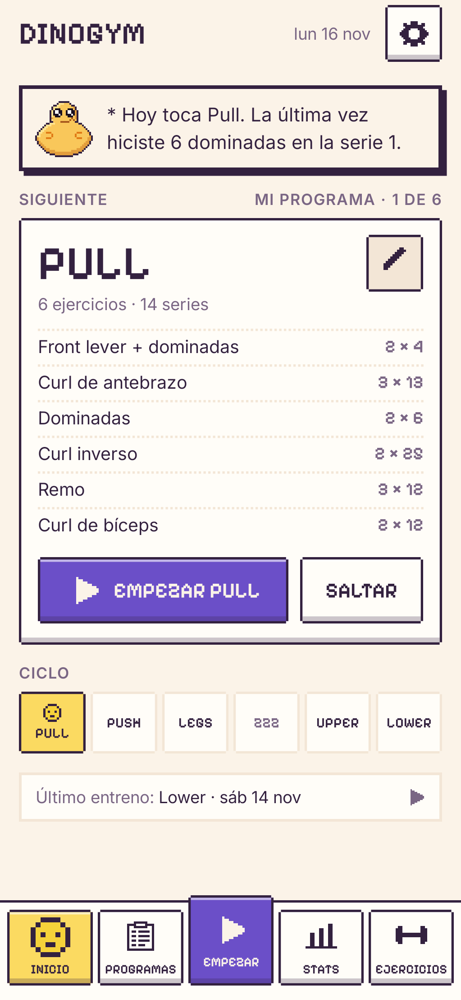
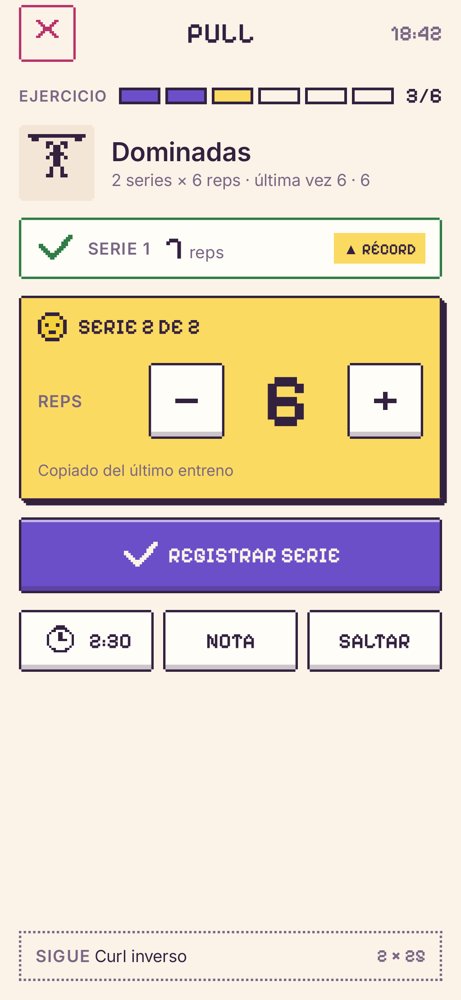
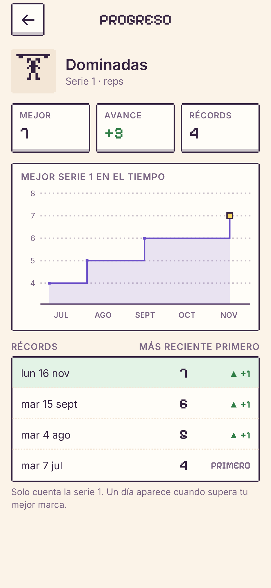
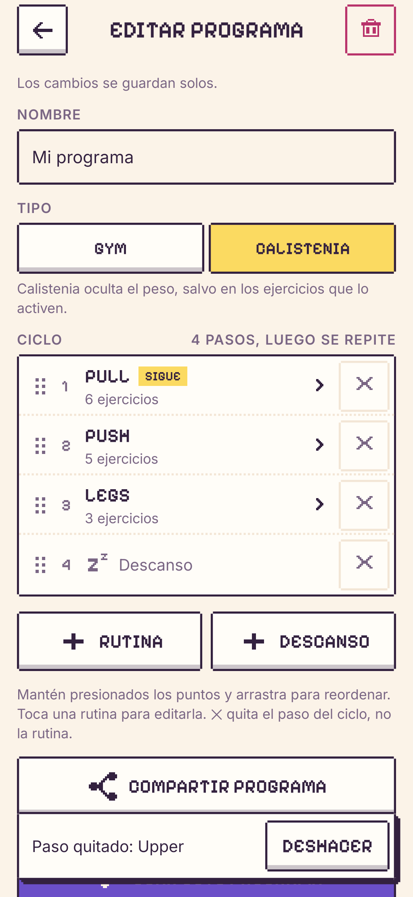
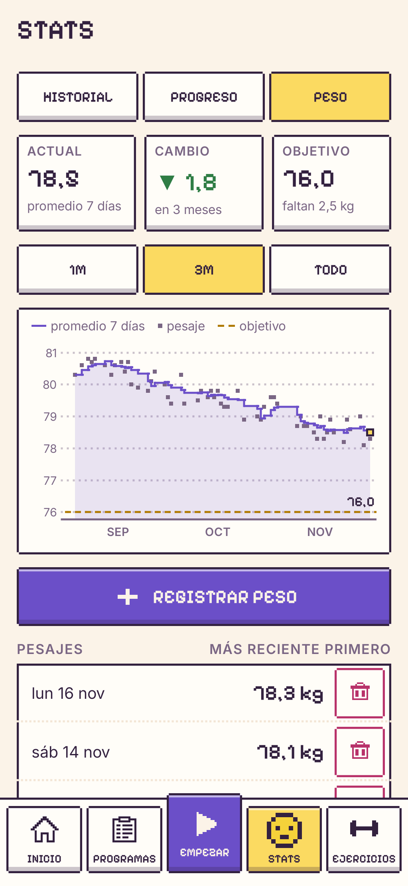
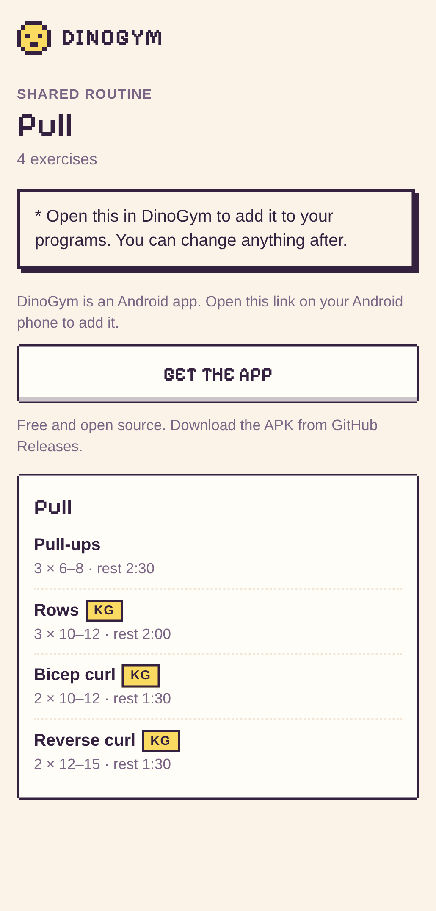
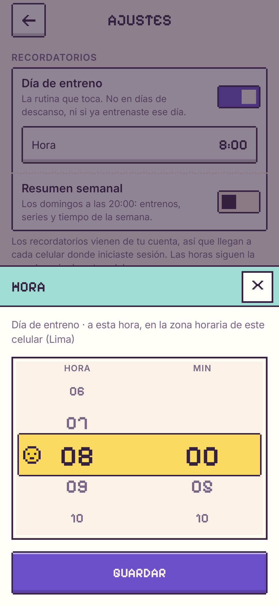
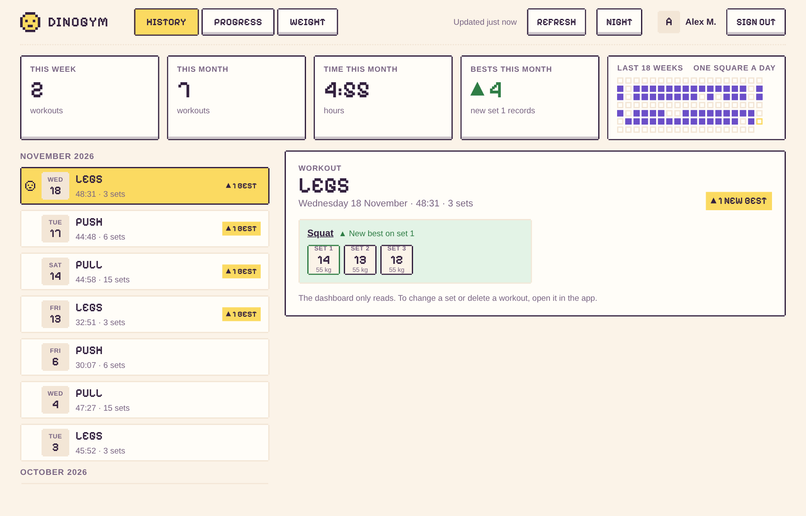
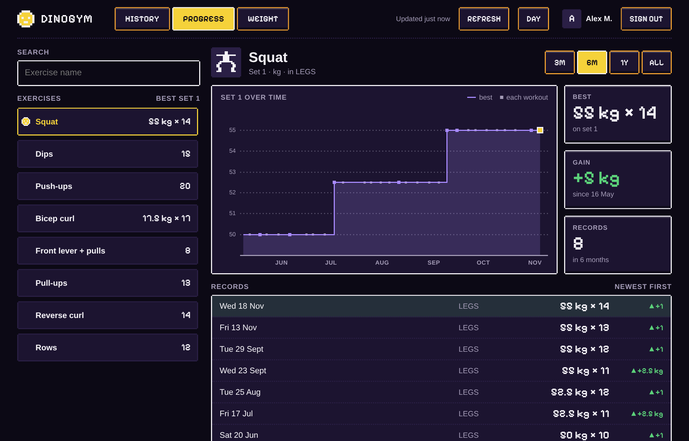
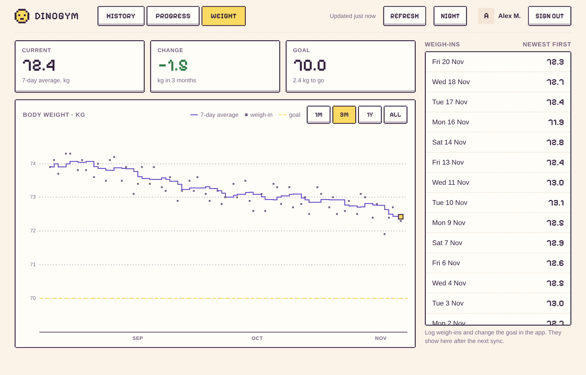

<h1 align="center">DinoGym</h1>

<p align="center">
  <strong>An offline-first workout tracker for gym and calisthenics, with a serverless AWS backend.</strong>
</p>

<p align="center">
  Native Android · Go on AWS Lambda · Terraform · Keyless CI/CD
</p>

<p align="center">
  
  
  
  
  
  
</p>

<p align="center">
  <a href="#architecture">Architecture</a> ·
  <a href="#cicd">CI/CD</a> ·
  <a href="#features">Features</a> ·
  <a href="#run-locally">Getting started</a> ·
  <a href="#documentation">Documentation</a>
</p>

DinoGym logs workouts on the phone with no connection needed, then syncs them through a Go API on AWS Lambda when it can. Sign-in, sync between devices, shareable routines, push reminders and a web dashboard all sit on a serverless stack that Terraform manages and that costs under $10 a month. Every pull request is tested against the AWS Emulator before anything touches real AWS. GitHub Actions deploys with OIDC, so no long-lived AWS keys exist anywhere.

<p align="center">
  
  
  
</p>

<p align="center">
  <a href="https://github.com/Pierorivera1/DinoGym/releases/latest"><strong>Download the latest APK</strong></a>
</p>

## Features

### Training, fully offline

- Follow a program as a rotating cycle of routines. Home shows what comes next, and rest days are part of the cycle.
- Log sets as reps or a custom metric, with optional weight. Each set is pre-filled from your last session.
- Run a rest timer that keeps going in the background and survives an app restart, as does the workout itself.
- Build programs from starter templates (Gym and Calisthenics Upper/Lower and PPL, 4-day Upper/Lower) or from scratch, using an exercise library with archive and restore.
- Track progress by the best first set, browse history by date and edit past sessions.
- Log body weight, with a 7-day average and a goal line.
- Use the app in English or Spanish, in a Night or Day theme.

| Programs | Body weight |
| --- | --- |
| [](docs/images/app-programs.png) | [](docs/images/app-weight.png) |

### Cloud features

- **Sign in with Google.** The phone gets a Google ID token, and the backend checks it and issues its own short-lived access tokens with single-use refresh tokens.
- **Sync between devices.** WorkManager pushes local changes and pulls by a server change number. The newest edit per row wins. The app stays fully usable if the backend is turned off.
- **Shareable routines.** Publish a routine as a public link. The link opens a static page on CloudFront, and the app imports the routine from it through Android App Links.
- **Reminders.** "Today is pull day" and a weekly summary, sent by EventBridge Scheduler and Firebase Cloud Messaging and timed to each phone's time zone.
- **Web dashboard.** History, progress and body weight after signing in, computed in the browser from synced data. It is read-only, because the phone is the only writer. SEE AN EXAMPLE on the sign-in page shows it with a made-up account, without signing in.

| Shared routine page | Reminder settings |
| --- | --- |
| [](docs/images/web-share.png) | [](docs/images/app-reminders.png) |

[](docs/images/web-history.png)

| Progress (Night) | Body weight (Day) |
| --- | --- |
| [](docs/images/web-progress.png) | [](docs/images/web-weight.png) |

## Architecture


The phone is the source of truth. Room holds every row locally, and the app never waits on the network. The backend is one Go binary per Lambda function, built from an OpenAPI 3 contract that also generates the Kotlin client and the dashboard's TypeScript types, so the three cannot drift apart unnoticed.

| Area | Technologies | Responsibility |
| --- | --- | --- |
| Android app | Kotlin, Jetpack Compose, Navigation 3, Room, WorkManager, Hilt, Ktor | Offline training, local storage, background sync, sign-in, notifications |
| API contract | OpenAPI 3.0.3, oapi-codegen, OpenAPI Generator, openapi-typescript, Redocly | One source for the Go server, Kotlin client and TypeScript types, linted in CI |
| Backend | Go on AWS Lambda (`provided.al2023`), API Gateway HTTP API | Auth, sync, shares, device registration, reminder scheduling |
| Data | DynamoDB (single table, on-demand), SSM Parameter Store (SecureString) | User data with a sync index, refresh tokens, signing keys |
| Reminders | EventBridge Scheduler, Lambda, Firebase Cloud Messaging | One schedule per user and reminder kind, push through FCM v1 |
| Web | React, TypeScript, Vite on S3 and CloudFront, a CloudFront Function | Dashboard, shared routine pages, same-origin API routing |
| Infrastructure | Terraform, S3 state with native locking | One module, one root per environment (emulator, staging, prod) |
| Observability | OpenTelemetry, Grafana Cloud, CloudWatch Logs, Firebase Crashlytics | Traces, metrics and logs, dashboards and alerts as code, app crashes |

The same Terraform module deploys three environments: the AWS Emulator, staging and prod, all in `us-east-1`. CloudFront serves the dashboard and the share page from one private S3 bucket and forwards API paths to API Gateway, so the browser talks to one origin and the API needs no CORS. There is no custom domain. The API Gateway and CloudFront default URLs keep the setup free of DNS and certificates.

## CI/CD


1. **Pull request.** Each part of the repository has its own workflow, triggered by path. Android builds, runs unit tests, lint and Roborazzi screenshot tests, then runs instrumented tests on an emulator in CI (never on the laptop). The API lints the contract, checks the generated code for drift and runs `go test`. The web workflow type-checks, tests and builds the dashboard.
2. **Emulator stage.** `infra/emulator/check.sh` starts a pinned AWS Emulator in Docker, runs the Go integration tests against its DynamoDB and Scheduler, then runs `terraform apply`, an empty second `plan` and `destroy` on the full stack. The laptop runs the same script.
3. **Merge to `main`.** `deploy.yml` reruns the emulator checks, builds the Lambda zips once and deploys staging. It signs in through GitHub OIDC, applies a saved `terraform plan` and polls `/health` and the public pages until they answer.
4. **Prod.** The `prod` GitHub environment waits for the owner's approval, then deploys the same zips with the same steps. Each environment deploys one run at a time, and a running apply is never cancelled.
5. **Release.** A `v*` tag builds a release APK signed with a keystore from GitHub secrets and attaches it to a GitHub Release.

### What the emulator proves

The AWS Emulator proves that the code and Terraform use the AWS APIs correctly, for free and before any deploy. It does not prove reliability, security or performance. It cannot run the Go Lambda, does not evaluate IAM, and is not tested under load. Staging on real AWS covers those gaps, and the [emulator report](docs/reports/aws-emulator/aws-emulator-report.pdf) records what was checked on the pinned version.

## Keyless access and observability


- **CI to AWS.** Each GitHub environment has its own IAM role, and each role trusts only jobs from this repository in that environment, matched by repository and owner IDs. A deploy role may manage only `dinogym-<env>` resources and may create roles only under a permissions boundary, so it cannot grant itself more access.
- **AWS to Google.** The reminder Lambda reaches FCM through workload identity federation. Google accepts the Lambda role's AWS identity and returns a short-lived token for a send-only service account. No Google key file exists.
- **Secrets.** Signing keys and the Grafana token live in SSM Parameter Store as SecureStrings. The owner creates them with the AWS CLI, so their values never enter Terraform state.
- **Telemetry.** The Go code is instrumented with OpenTelemetry and flushes after every invocation. Grafana Cloud holds traces, metrics and logs, and its dashboards and alerts are defined in Terraform. CloudWatch keeps a 7-day safety net of Lambda logs, and Crashlytics reports app crashes.
- **Cost.** An AWS Budgets alert emails at 50% and 100% of $10 a month, and API Gateway throttling caps runaway traffic.

## Run locally

Requirements: JDK 21 and the Android SDK, Go 1.27, Node.js 26, Terraform 1.17.2 and Docker. Go and Terraform versions are pinned with mise.

### Android app

```bash
cd android
./gradlew :app:assembleDebug        # build the debug APK
./gradlew :app:testDebugUnitTest    # unit tests, Room DAO tests and Roborazzi screenshots
```

Open `android/` in Android Studio to run it on a device. Builds without Firebase or Google credentials still work offline; sign-in and reminders are then off.

### Backend on the AWS Emulator

```bash
infra/emulator/start.sh            # builds and starts the pinned emulator in Docker
source infra/emulator/env.sh       # point this shell's AWS SDK and CLI at it
cd backend
DINOGYM_TELEMETRY=console go run ./cmd/api   # http://127.0.0.1:8080
```

Run the emulator checks that CI runs on every pull request:

```bash
infra/emulator/check.sh            # Go integration tests, then Terraform apply, re-plan and destroy
```

### Web dashboard

```bash
cd web/dashboard
npm ci
npm run dev                        # http://localhost:5173, API calls proxied to staging
```

Press SEE AN EXAMPLE on the sign-in page to see every view with two months of made-up workouts, built in the browser. Nothing is sent to the API.

## Design and tradeoffs

- **Lambda over containers.** The API is a zipped Go binary on `provided.al2023`, with no image registry or cluster to run. The same binary also runs as a local HTTP server.
- **One DynamoDB table.** Every entity lives in one table with one index for sync, so a device pulls every change after its cursor with a single query. On-demand billing fits a few users.
- **Last write wins.** Sync keeps the newest edit per row. Merging fields would be safer for concurrent edits, but one person rarely edits the same set on two phones at once.
- **A read-only dashboard.** The phone is the only writer, so the web adds no conflict cases. The progress rules are ported to TypeScript with their tests instead of being computed by a new endpoint.
- **Emulator first, staging second.** The emulator catches wrong API usage for free. Staging exists because the emulator cannot prove IAM, Lambda execution or CloudFront at the edge.

Every choice, with the alternative it beat, is recorded in [docs/DECISIONS.md](docs/DECISIONS.md).

## Documentation

- [Project scope](docs/PROJECT.md), [stack](docs/STACK.md) and [task list](docs/TASKS.md).
- [App architecture and data model](docs/ARCHITECTURE.md) and [design guide](docs/DESIGN.md).
- [Emulator-first workflow](docs/WORKFLOW.md) and the [AWS Emulator report](docs/reports/aws-emulator/aws-emulator-report.pdf).
- [Infrastructure, bootstrap and deploys](infra/README.md), [backend](backend/README.md) and [web dashboard](web/dashboard/README.md).
- [Releases](docs/RELEASE.md) and [decisions](docs/DECISIONS.md).
- [Diagram sources](docs/architecture/README.md).

## License

[MIT](LICENSE). Bundled fonts keep their own licenses. Diagram logos are trademarks of their owners and come from AWS Architecture Icons, Google Cloud product icons, svgl, devicon and Lucide.
