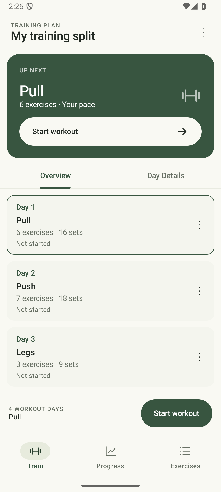
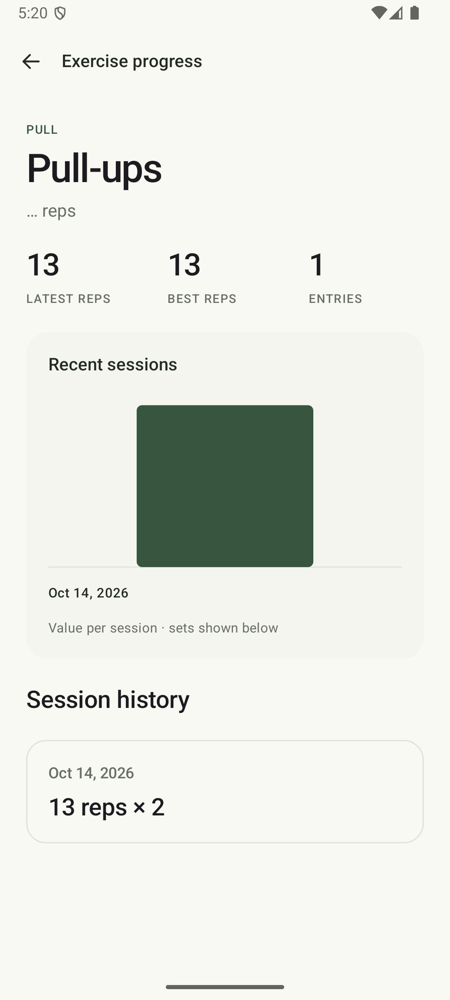
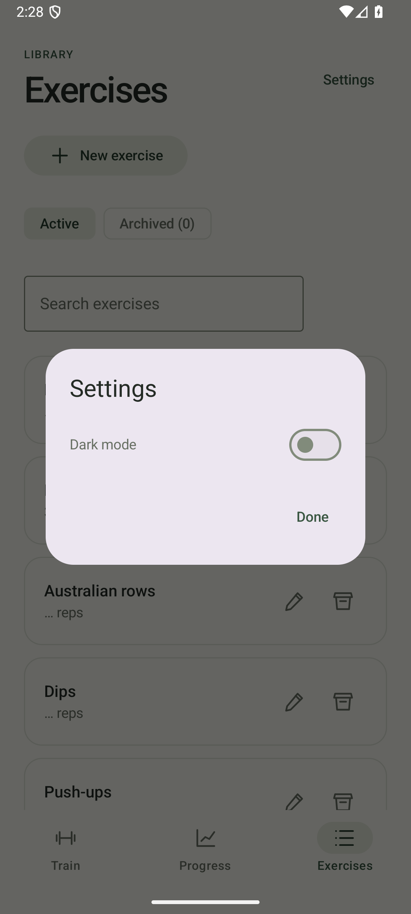

# DinoGym

DinoGym is a native Android workout tracker for bodyweight training. Build a training split, log individual sets, and review your progress. Workouts, exercise definitions, and history stay on your device and work offline.

## Screenshots

| Training | Progress | Settings |
| --- | --- | --- |
|  |  |  |

## Install

[Download the latest APK](https://github.com/Pierorivera1/DinoGym/releases/latest/download/app-debug.apk) from GitHub Releases. Open it on an Android 8.0+ device and allow installation from the download source if Android asks. Releases currently use debug APKs.

The release APK follows the latest published tag; changes on `main` are available by building from source until a new release is published.

## Features

- **Training plans:** create named workouts and rotating splits, hold the six-dot handles to reorder exercises, delete workouts from Manage workouts & splits, and set independent targets for each workout. Completing the next workout advances the split.
- **Set logging:** record repetitions or a custom metric, with optional weight in kilograms. Log a set to focus the next unfinished set; log the last set to open the next unfinished exercise automatically. Only logged sets are saved, and you can update workout targets when finishing.
- **Rest timers:** configure up to nine minutes of rest between sets, pause or skip it, and adjust by 15 seconds. The last set skips automatic rest. Timers continue in the background and finish with about two seconds of sound, without vibration.
- **Exercise library:** create exercises from the library or directly from an Add exercise picker. Reuse exercises across workouts, edit them, or archive and restore them while preserving saved history.
- **History and progress:** browse sessions by date, correct saved sets, and delete sessions after confirmation. Charts show weekly best-set values, with workout-specific filtering. Weeks start on Monday; missing weeks are not recorded as zero.
- **Resume and appearance:** resume saved workout drafts after restarting the app. Fresh installs start in light mode; dark mode uses sage green accents on charcoal surfaces. Your choice is saved. Wider layouts use a navigation rail.

Custom exercise templates contain exactly one `{n}` placeholder and a metric unit. For example, `3s + {n} pulls + 3s` with unit `pulls` tracks repetitions while keeping the holds fixed. Workout screens have no notes input; notes in older history are preserved.

## Build and run

Use JDK 17 and Android SDK Platform 36. Open the repository root in Android Studio, sync Gradle, and run the `app` configuration on an Android 8.0+ phone or emulator. The project compiles and targets API 36; its minimum is API 26.

From the repository root:

```bash
./gradlew :app:assembleDebug
./gradlew :app:installDebug
```

The first command creates `app/build/outputs/apk/debug/app-debug.apk`; the second installs it on a connected device. Initial builds need internet access to download dependencies. The Gradle wrapper is included; on Windows, use `gradlew.bat`.

Compose previews and synthetic preview data are in [Previews.kt](app/src/main/java/com/dinogym/ui/main/Previews.kt).

## Architecture

The app uses Kotlin, Jetpack Compose with Material 3, Navigation 3, AndroidX lifecycle, and Kotlin serialization. Versions are centralized in [gradle/libs.versions.toml](gradle/libs.versions.toml).

| Location | Responsibility |
| --- | --- |
| [ui/main/](app/src/main/java/com/dinogym/ui/main/) | Training, planning, workout logging, history, and progress screens |
| [WorkoutViewModel.kt](app/src/main/java/com/dinogym/ui/main/WorkoutViewModel.kt) | Screen state, save operations, and draft persistence |
| [data/](app/src/main/java/com/dinogym/data/) | Models, validation, progress calculations, JSON encoding, and local storage |
| [timer/](app/src/main/java/com/dinogym/timer/) | Foreground rest timer and completion sound |
| [Navigation.kt](app/src/main/java/com/dinogym/Navigation.kt) | Screen navigation and action wiring |
| [theme/](app/src/main/java/com/dinogym/theme/) | Compose colors and typography |

Storage uses a local JSON snapshot rather than a database. This keeps persistence small; each save rewrites the snapshot. Repository writes use `AtomicFile` to protect against partial writes, and failed reads preserve the saved file and report an error.

## Data and limitations

Data lives in the app's private directory: `workouts.json` stores exercises, plans, splits, and sessions; `active-workout.json` stores the current draft. Legacy workout files are decoded on load, and the first save retains the original as `workouts-v1.backup.json` before upgrading to schema version 2.

There are no accounts, cloud sync, or export/import tools. Android backup and device transfer are disabled. Uninstalling the app or clearing its storage removes local data.

Splits rotate by workout completion rather than weekdays. Rest sounds respect alarm volume and device audio policy; force-stopping the app stops the timer. Verify background sound on the physical device you use for training.

## Verify and contribute

Run unit tests and Android Lint:

```bash
./gradlew :app:testDebugUnitTest :app:lintDebug
```

With a running emulator or connected device, run UI, storage, and timer tests:

```bash
./gradlew :app:connectedDebugAndroidTest
```

Keep changes focused and follow the existing feature and data organization. Run device tests for UI or timer changes. Keep machine-specific files, build output, signing keys, and credentials out of commits.

The [release workflow](.github/workflows/release-apk.yml) builds and publishes a debug APK when a `v*` tag is pushed. Production signing and release minification are not configured.

No license file is included in this repository.
