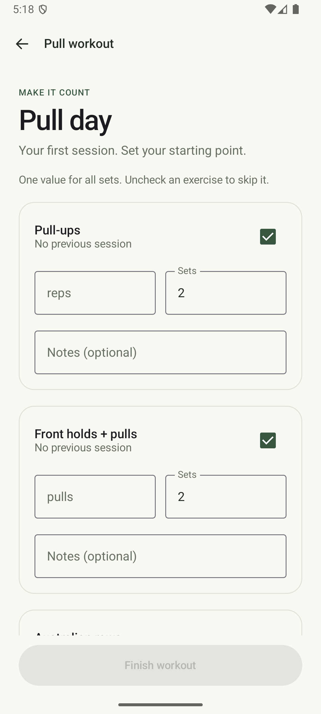
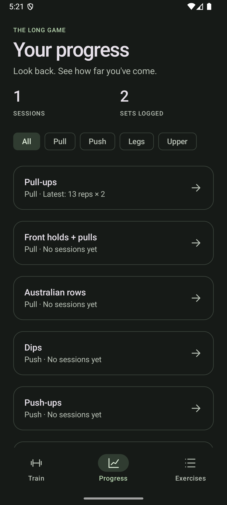
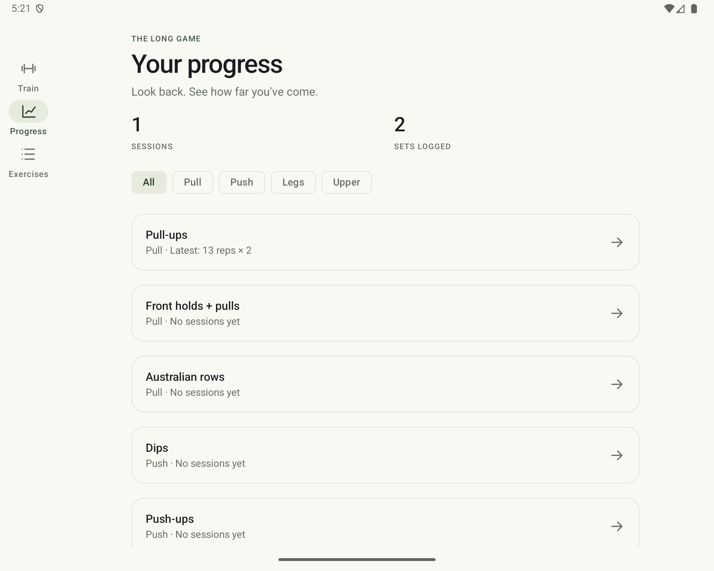

# DinoGym

DinoGym is a native Android workout tracker for recording bodyweight training and reviewing progress. It is designed for quick logging during a workout, with local storage so logging and history work offline.

## Screenshots

| Training | Workout logging | Progress | Dark theme | Tablet layout |
| --- | --- | --- | --- | --- |
|  |  |  |  |  |

## Features

- **Plan training:** create named workouts and rotating training splits, reorder their exercises/workouts, and choose the split to follow. The home screen shows the next workout and advances after it is completed.
- **Log workouts:** open the compact exercise overview, edit individual sets with reps (or a custom metric), optional kilograms, and notes, then mark sets logged. Only logged sets are saved. Optionally update workout targets when finishing.
- **Share exercises:** maintain one exercise library and add the same exercise to multiple workouts with independent targets. Create exercises with a display template containing exactly one `{n}` placeholder and a metric unit. For example, `3s + {n} pulls + 3s` keeps the holds fixed while tracking pull repetitions.
- **Manage exercises:** edit exercises, archive them after confirmation, and restore them from the Archived list. Archived exercises stay out of new workouts; saved history keeps its original exercise details.
- **Manage workouts:** expand sessions in workout history, correct their values, sets, and notes, or delete a session after confirmation. Editing preserves the session's ID and date.
- **Review progress:** compare a workout with the previous session, expand saved workout history, and view recent per-exercise performance in a chart.
- **Stay focused:** highlight the next set, show the exercise's previous results and notes, reveal optional weight fields when needed, and move straight to the next exercise. Adjust an active or paused rest by 15 seconds, and filter workout history with the training calendar.
- **Resume and rest:** active session drafts survive app restarts. Logging a set starts its configurable rest timer; pause, resume, restart, or skip it. A quiet ongoing notification supports background rest, with a sound-only completion alert and no vibration.
- **Use it offline:** workouts and custom exercises are stored on the device and remain available after restarting the app.
- **Adapt to the device:** use the system light or dark appearance, with wider layouts showing a navigation rail. Android wallpaper colors can be enabled in the app theme.

## Requirements

- Android Studio with Android Gradle Plugin support for the versions in `gradle/libs.versions.toml`
- Android SDK Platform 36
- JDK 17 (Android Studio's bundled Gradle JDK is suitable)
- Android device or emulator running Android 8.0 (API 26) or newer

The application targets API 36 and has a minimum supported API level of 26. Gradle resolves dependencies from Google's Maven repository, Maven Central, and the Gradle Plugin Portal, so an internet connection is needed for the initial sync/build.

## Open and run in Android Studio

1. Clone or download the repository and open the **repository root** (`DinoGym`) in Android Studio. If Android Studio currently has the folder open as a plain project, choose **File → Open** and select this root folder to import the Gradle project.
2. Allow Gradle sync to complete. If prompted, install Android SDK Platform 36 and select JDK 17 as the Gradle JDK.
3. Select the `app` run configuration and an API 26+ device or emulator.
4. Press **Run**. Android Studio installs the debug build on the selected device.

Compose previews are in `app/src/main/java/com/dinogym/ui/main/Previews.kt`. Open that file and use the editor's Split or Design view to inspect the sample light, dark, workout, progress, exercise, and wider-screen layouts. Preview data is separate from installed app data.

## Build from the command line

From the repository root, build the debug APK:

```bash
./gradlew :app:assembleDebug
```

The APK is created at `app/build/outputs/apk/debug/app-debug.apk`. Install it on a connected device with:

```bash
./gradlew :app:installDebug
```

Run the local checks with:

```bash
./gradlew :app:testDebugUnitTest :app:lintDebug
```

Instrumented tests require a running emulator or connected Android device:

```bash
./gradlew :app:connectedDebugAndroidTest
```

The Gradle wrapper is included, so a separate Gradle installation is not required. On Windows, use `gradlew.bat` in place of `./gradlew`.

## Project structure

```text
.
├── app/
│   └── src/
│       ├── main/java/com/dinogym/
│       │   ├── data/           # Workout models and local JSON repository
│       │   ├── theme/          # Compose theme and typography
│       │   ├── ui/main/        # Training, workout, progress, and previews
│       │   ├── MainActivity.kt
│       │   └── Navigation.kt
│       ├── test/               # Local unit tests
│       └── androidTest/         # Device and UI tests
├── docs/screenshots/           # App screenshots used in this README
├── gradle/                     # Wrapper and version catalog
├── build.gradle.kts            # Root Gradle plugins
└── settings.gradle.kts         # Gradle project and repositories
```

The app uses Kotlin, Jetpack Compose with Material 3, AndroidX lifecycle and Navigation 3, Kotlin serialization, and Gradle Kotlin DSL. Dependency and plugin versions are centralized in `gradle/libs.versions.toml`.

## Data and privacy

Workout data is stored locally in the app's private files directory as `workouts.json`; the active draft is stored separately as `active-workout.json`. Version 2 stores shared exercises, workout templates, splits, and individual set records. Legacy files are decoded without being rewritten until a normal save; that first save retains the original in `workouts-v1.backup.json`. Known matching starter duplicates are consolidated, while customized variants and historical display details are preserved. Writes use Android's `AtomicFile` support to reduce the chance of a partial write. If stored data cannot be read, the app reports the problem and preserves the file instead of replacing it with empty history. The app does not currently include accounts, cloud synchronization, export/import, or a supported backup-and-restore flow. Uninstalling the app or clearing its storage removes local workouts and custom exercises; export important data before doing so once an export feature is available.

There is no network requirement during workout logging. Gradle does download build dependencies when syncing or building the project.

## Current scope and limitations

- Weight is optional and uses kilograms. Splits rotate by completion rather than weekdays.
- Rest sounds respect device audio policy; force-stopping the app stops the timer. Background sound should also be verified on the target physical device. The Android 14+ foreground service declares its workout-timer special use; distribution through Google Play requires the corresponding foreground-service declaration/review.
- Charts show the best recorded set value per session across all workouts for an exercise; history includes every logged set and optional weight.
- Persistence currently uses a single local JSON snapshot. Room/SQLite migrations, cloud sync, and multi-device conflict handling are future work.
- The release build is not configured for minification or production signing. Keep signing keys and credentials outside version control when adding a release workflow.

## Contributing

Keep changes focused and consistent with the existing feature and data organization. Before opening a change, run the unit tests and Android Lint commands above; run instrumented tests when changing UI flows or device-specific behavior. Do not commit machine-specific `local.properties`, build output, IDE state, signing keys, or credentials.

## License

No license has been added to this repository yet. All rights remain with the copyright holder until a license is provided.
