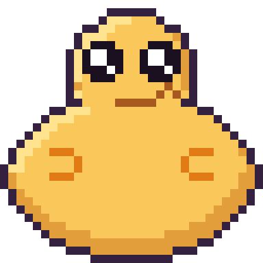

# Pixel style: what we take from the references

Status: draft, 2026-11-16. Piero answered the first round of questions on 2026-11-16 (decision 25). When it is approved, the tokens and components here become `docs/DESIGN.md`, the style guide for Android (Compose, Material 3) and the React web pages.

## The rule

DinoGym looks like a pixel-art game, but it works like a tool.

- **We take the style, not the art.** Nothing from `references/` ships in the app or the website. That includes characters, sprites, fonts and logos. Every icon, sprite and font we use is drawn by us or comes with an open license.
- **We are inspired by Undertale and Deltarune. We don't copy them.** We don't use their characters or their FIGHT / ACT / ITEM / MERCY labels, and we don't use the Determination font or the red soul heart as our cursor. Our own mascot, a round yellow blob (see Mascot), is our character.
- **Readability comes before style.** If the pixel look makes a button harder to find, read or press, the look gives way. Someone mid-set, out of breath and holding a phone in a sweaty hand, has to read a number and tap a button on the first try.

## What the references have in common

The `references/` folder holds two families of images. The app takes one family for each theme.

### Family A: Undertale / Deltarune (`references/undertale/`)

| Reference | What we take from it |
|---|---|
| Battle HUD (black screen, white box, orange buttons, `LV 1  HP 20/20`) | A dark background, one thick white outlined box for the main content, and a row of large boxed actions at the bottom. Stats are written as short labels next to a bar. |
| FIGHT / ACT / ITEM / MERCY buttons | Each button is a rectangle with a 2 to 3 pixel outline, an icon on the left and an all-caps label. When selected, the button turns yellow and the icon is replaced by the cursor. |
| Soul heart | A single chunky, flat sprite in one colour with no shading reads instantly. Our selection cursor gets the same treatment, using our own shape. |
| Pixel font sheet | Blocky letters on a square grid with very thick strokes. Good for headings and numbers. Too heavy for long text. |
| Item icons (Stick, Toy Knife...) | Icons with a white 1-pixel outline on black, a few flat colours, and a short label underneath. |
| Character lineup | Characters with dark outlines and limited palettes, roughly 2 to 3 tones per colour. A guide for the mascot's sprite. |
| Purple landing pages | Proof that this style works for a web page: deep violet-black background, violet accent, white pixel headings, outlined pixel buttons, small `*` dialog boxes and soft glow behind key elements. This is the model for the React pages. |

**The feel:** dark, quiet, high contrast, a little melancholic and a little funny. Colour is spent only where it means something.

### Family B: pastel pixel art (`references/pixel-art/`)

| Reference | What we take from it |
|---|---|
| Pastel desktop icon sheet | A warm cream and pink background. Outlines are dark plum, not black. Fills are butter yellow, pink and teal, with 1 to 2 shading steps. The icons look friendly, not retro-harsh. |
| Zelda-style item icons | Very small icons (about 16×16) that still read clearly thanks to a dark outline and one highlight pixel. |
| TOTK icon grid | Icons sitting on a rounded square tile in a lighter shade of the background. This works well for an exercise library grid. |
| Card screen (LSP, `LEVEL 5/20`, `LEVEL UP` button) | Chunky panels with a darker bottom edge so they look raised. Big rounded-pixel buttons with a lighter top band. Stat rows (`ATTACK 65`) have the label on the left and a big number on the right. This is the direct model for logging sets. |
| Character Select window | A window frame with a title bar and a close box, an inner panel with a 1-pixel inset line, and simple `Label: value` rows. This is the model for sheets and dialogs. |

**The feel:** bright, soft, cosy and playful. It looks like a game menu, not an arcade cabinet.

### How the two families combine

- **Dark theme ("Night") = Family A.** It uses near-black violet surfaces, white outlines and saturated accents.
- **Light theme ("Day") = Family B.** It uses cream surfaces, plum outlines and pastel fills.

Both themes share the same pixel grid, shapes, fonts, components and mascot. Only the colours change, so one set of components covers both.

## Style pillars

1. **Hard edges.** Corners are square or stepped, never smoothly rounded. Shadows have no blur. Gradients appear only as dithering, if at all.
2. **Visible outlines.** Every interactive element has a 2dp outline, so its edge is obvious without relying on colour.
3. **Few colours, each with a meaning.** One neutral ramp plus 4 accents. Each accent has a fixed job (see Colour).
4. **Big numbers.** Reps, weight and the timer are the largest text on the screen.
5. **Game look only, no game mechanics.** No streaks, levels, XP or `LV`/`HP` stats. The game feel comes from how things look, not from scoring the user. Layouts stay ordinary mobile screens a user already knows how to use.

## The pixel grid

- **1 art pixel = 2dp at the base size.** Borders, icons and sprites are drawn on this grid, so a 2dp border is exactly one art pixel thick. Large sprites like the mascot or empty-state art can use 3dp or 4dp per pixel, always in whole steps.
- **Spacing uses a 4dp scale:** 4, 8, 12, 16, 24, 32, 48.
- **Touch targets are at least 48×48dp**, even when the visible box is smaller.
- **Edges and corners** follow these rules:
  - Square corners by default.
  - **Stepped corners** for raised components: notch one art pixel out of each corner. This gives the "rounded pixel" look of the LSP card and Character Select window.
  - Never use `RoundedCornerShape` with a radius.
- **Raised components** like buttons and cards get a 1 art-pixel lighter band at the top and a 2 art-pixel darker band at the bottom (from the LSP card). When pressed, the component moves down 2dp and the bottom band disappears.
- **Shadows** are a hard offset of 4dp down and 4dp right, in the outline colour, with no blur. Use them only on floating elements: dialogs, the active set card and toasts.

## Colour

All pairs below were checked against WCAG 2.1. Every text pair passes AA, which needs a ratio of 4.5:1 or more. Some colours are sampled from the references, and some are adjusted until they pass.

### Night (dark theme)

| Token | Hex | Job | Contrast |
|---|---|---|---|
| `bg` | `#0C0915` | Screen background (violet-black, from the landing pages) | – |
| `surface` | `#1C1430` | Cards, boxes, sheets | – |
| `outline` | `#F4F2F7` | Borders of boxes and buttons, main text | 17.7 on `bg`, 15.9 on `surface` |
| `text-muted` | `#A39BB6` | Labels, secondary text | 7.4 on `bg`, 6.6 on `surface` |
| `primary` | `#A98BFF` | Brand violet: main actions, links, the selected tab | 7.3 on `bg`, and `bg` text on it is 7.3 |
| `select` | `#F5D23A` | Selected or focused item, the active set (yellow, like a selected battle button) | 13.3 |
| `action` | `#F0A030` | Secondary actions (orange, like the unselected battle buttons) | 9.2 |
| `danger` | `#FF4D4D` | Delete, end workout, errors | 6.0 |
| `success` | `#5CD27A` | Completed set, new personal best | 10.3 |

### Day (light theme)

| Token | Hex | Job | Contrast |
|---|---|---|---|
| `bg` | `#FBF3E8` | Screen background (cream, from the pastel icon sheet) | – |
| `surface` | `#FFFDF8` | Cards, boxes, sheets | – |
| `outline` | `#33213F` | Plum outline and main text (never pure black) | 13.4 on `bg` |
| `text-muted` | `#7A6684` | Labels, secondary text | 4.7 on `bg` |
| `primary` | `#6B4FC8` | Brand violet | 5.3, and `bg` text on it is 5.3 |
| `select` | `#FBDA61` | Fill for the selected item (butter yellow) | `outline` text on it is 10.7 |
| `pink` | `#F2B6C6` | Decorative fill, tags | `outline` text on it is 8.6 |
| `teal` | `#9FDCD4` | Decorative fill, info | `outline` text on it is 9.6 |
| `danger` | `#B8326A` | Delete, errors | 5.2 |
| `success` | `#2F7D45` | Completed set, new personal best | 4.6 |

Rules:

- Colour is never the only signal. A completed set also gets a check icon, and the selected item also gets the cursor.
- Pastel fills are backgrounds only. Text on them is always `outline`.
- These colours replace the Material You wallpaper colours: the app keeps its own palette.

## Typography

There are two roles. Pixel fonts look great large and get tiring when small or long, so the pixel font is used only where text is short and big. Everything the user reads is in a plain sans (Piero, 2026-11-16: "the app text should be readable").

| Role | Used for | Font (open license) |
|---|---|---|
| **Display** (pixel) | Screen titles, buttons, bottom navigation labels, big numbers (reps, weight, timer) | **Pixelify Sans** (OFL, 4 weights, the most readable pixel font found). Alternative to test: Silkscreen (OFL) for short all-caps labels |
| **Body** (plain) | Exercise names in lists, notes, descriptions, settings, history, anything longer than a few words | **Inter** (OFL). Same file on Android and web, wide Latin coverage including Spanish |

Proposed type scale:

| Style | Size | Font | Example |
|---|---|---|---|
| `number-xl` | 56sp | Display | `12` reps, `01:30` timer |
| `title` | 28sp | Display | `PULL DAY` |
| `heading` | 20sp | Body, semibold | Exercise name |
| `button` | 18sp | Display, all caps | `LOG SET` / `REGISTRAR` |
| `body` | 16sp | Body | Notes |
| `label` | 14sp | Body, all caps | `REPS`, `KG`, `REST` |

Rules:

- Pixel fonts render only at their designed size or whole multiples of it, so they stay crisp. Pick the final sizes after testing on the real font.
- The text scales with the system font size, and layouts must survive 200% scaling.
- **The font must cover Spanish:** á é í ó ú ü ñ ¿ ¡, in uppercase too. Check this before choosing a font.
- Spanish strings run about 20 to 30% longer than English. Buttons wrap or shrink to the next size, and they never cut text off.
- Do not use Press Start 2P or similar very wide fonts for UI text. They are fine for a logo only.

## Components

Each component lists the reference it comes from and how it is used in DinoGym.

### Action button (from the battle buttons and the LSP `LEVEL UP` button)

- A boxed rectangle with a 2dp outline, stepped corners, an icon on the left, an all-caps label and the raised bands.
- **Primary** buttons are filled with `primary`. **Secondary** buttons are outlined with an `action`/`outline` stroke.
- **Selected or focused:** the fill or outline changes to `select` and the mascot cursor replaces the icon. This mirrors how a selected battle button turns yellow.
- Bottom action rows hold at most 4 buttons, for example the actions under the active exercise: `LOG`, `REST`, `SKIP`, `NOTE`.

### Selection cursor (from the soul heart, made our own)

- A small sprite of the mascot's face (8×8 art pixels). It marks the current item in lists and menus, the selected tab and the active set.
- It moves in steps, not smoothly.

### Text box (from Undertale's dialog box and the `* It's a beautiful day` box)

- A full-width box with a thick 3dp outline. Text starts with `*` and appears letter by letter. Tapping shows all of it at once.
- **Use it for:** the mascot's voice, such as rest-over messages, empty states, the first-run tutorial, the post-workout summary and personal-best messages.
- **Do not use it for:** errors that block the user, or anything the user must read to continue. Those use a normal dialog.
- Example: `* You feel stronger. New best on push-ups: 22 reps.` / `* Te sientes más fuerte. Nuevo récord en flexiones: 22 reps.`

### Stat bar (from `HP 20/20` and `LEVEL 5/20`)

- A short label, a segmented bar made of blocks rather than a smooth fill, and a `current / total` number.
- **Use it for:** the rest timer (`REST ▮▮▮▮▯▯ 0:45`), the sets done in an exercise (`SETS 3/5`) and the workout progress in the top bar.

### Stat panel (from the LSP card's `ATTACK 65` rows)

- Label on the left in `text-muted`, value on the right in `number-xl` or `heading`.
- **Use it for:** set input (`REPS 12`, `KG 20`) with large − / + steppers, and the history and progress summaries.

### Window / sheet (from the Character Select window)

- A title bar with the title on the left and a square close box on the right. Underneath is an inner panel with a 1dp inset line.
- **Use it for:** bottom sheets, dialogs, and editing an exercise or workout.

### Exercise card and tile (from the TOTK icon grid and the item icons)

- In the library, a tile in a lighter shade of the background holding a 16×16 pixel icon for the exercise type, with the name underneath.
- In lists, a row with the icon, the name and the target (`3 × 8–12`).

### Icons

- Drawn by us on a 16×16 grid and displayed at 32dp or 48dp (2× or 3×).
- A 1 art-pixel outline in the `outline` colour, 2 to 3 flat tones and one highlight pixel.
- One style for the whole set. Material Symbols are not mixed in.
- A first list: workout, plan or split, library, history, progress, timer, settings, add, delete, edit, drag handle, check, sync, offline, share, Google account.

### Bottom navigation

Piero's direction (2026-11-16): the bottom bar uses the battle-button style for five destinations.

| Tab | English | Spanish |
|---|---|---|
| 1 | HOME | INICIO |
| 2 | PROGRAMS | PROGRAMAS |
| 3 (centre) | START | EMPEZAR |
| 4 | STATS | to decide (`ESTADÍSTICAS` is too long) |
| 5 | EXERCISES | EJERCICIOS |

- Each tab is its own boxed button with a 2dp outline in `action` orange and stepped corners, with the pixel icon on top and the pixel label underneath. Five side-by-side boxes do not fit icon-left-of-label at 360dp, so the icon goes on top.
- **Selected tab:** the box and label turn `select` yellow and the mascot cursor replaces the icon, like a selected battle button.
- **START** is bigger and filled with `primary`, and it sits slightly raised above the bar, like the centre button in Piero's screenshot. It starts the next workout in the plan.
- **Width check:** at 360dp each tab is about 64dp wide, which fits about 8 pixel-font capitals at 11 to 12sp. `EXERCISES`, `EJERCICIOS` and `PROGRAMAS` are 9 to 10 letters, so the font-test page must prove they fit. If they don't, the labels switch to the body font (Inter, 12sp caps), and the boxes keep the battle-button look.

### Charts (progress)

- A stepped line or block bars on a pixel grid, with no anti-aliased curves. Points are 2×2 art-pixel squares, and the axis labels use the display font.

## Motion and feedback

- **Stepped movement.** Animations move in visible steps (3 to 6 frames), not smooth easing. This applies to the cursor, raised buttons and bar fills.
- **Typewriter text** in text boxes runs at about 40 characters per second, and a tap skips it.
- **Small celebrations:** a completed set flashes once and plays a short haptic. A personal best gets a mascot sprite pop and a text box. These are short, and none of them blocks input.
- **Sound** is off by default. If it is added later, it is 8-bit style, our own, with a setting to turn it off.
- **Reduced motion:** when the system asks for less animation, typewriter text and flashes are turned off.

## Where game flavour stops

The vibe comes from:

- the look
- the mascot's voice
- small moments, such as a personal-best message

There are no streaks, levels or XP. Stat bars borrow the `HP 20/20` look, but their labels are plain (`REST`, `SETS`).

It never makes the app slower or less clear:

- Standard mobile navigation and gestures, such as back, swipe and the bottom navigation.
- Words are plain first, playful second. The button says `LOG SET`, not a game pun.
- Data screens (history, charts, settings) are calmer: fewer text boxes and more plain panels.
- Every string is translated, including the mascot's lines, in English and Spanish.

## Material 3: what we keep and what we replace

- **Keep:** M3 components for behaviour and accessibility (buttons, sheets, navigation bar, text fields, snackbars), semantics, focus handling and the colour-role structure.
- **Replace:**
  - `ColorScheme` uses our tokens, with no dynamic colour.
  - `Typography` uses our pixel fonts.
  - `Shapes` uses square or stepped shapes.
  - Elevation becomes outlines and hard shadows.
  - Ripples become a pressed state, the 2dp downward shift.
- **Build custom:** the stepped-corner `Shape`, the raised button, the text box with typewriter text, the segmented stat bar and the pixel icons (as vector drawables drawn on the grid).

## Web (React)

- The same tokens are defined as CSS custom properties: Night for `prefers-color-scheme: dark`, Day for light.
- Pixel images use `image-rendering: pixelated`, and fonts load from the same open-licensed files the app uses.
- The public routine page and the landing page follow the purple landing-page reference: a big pixel heading, a mascot sprite scene, outlined buttons and a `*` text box. The dashboard follows the app's data screens.

## Do and don't

| Do | Don't |
|---|---|
| Use outlines on every interactive element | Use soft drop shadows, blur or glassmorphism |
| Make numbers big and use pixel fonts for short text | Set paragraphs in a heavy pixel font |
| Use stepped or square corners | Use rounded corners with a radius |
| Draw our own sprites and icons on the grid | Use sprites, fonts or labels from the reference games |
| Give each accent one job | Make every element colourful |
| Use dithering for texture, if anything | Use smooth gradients |
| Use our mascot as the cursor and the voice | Use the red heart as a cursor |

## Mascot

Piero chose a round yellow blob with big glossy eyes, a lopsided smirk and small orange arms. The pixel version is drawn on a 32×32 grid in the style rules above: plum outline, three yellow tones with light from the top left, orange arms and black eyes with a two-part highlight.

- Sprite: [mascot/mascot-32.png](mascot/mascot-32.png) at 1× and [mascot/mascot-384.png](mascot/mascot-384.png) at 12× for viewing.
- Source: [mascot/draw_mascot.py](mascot/draw_mascot.py) draws it pixel by pixel from shapes, so it can be changed and redrawn instead of edited by hand.
- Still to make: the 8×8 face for the cursor, a few poses (idle, happy, resting, celebrating) and the launcher icon.

## Open questions for Piero

Answered on 2026-11-16: Night follows Undertale and Day follows pastel; game look only, with no streaks or stats; pixel font only for short, big text; the yellow blob is the mascot; `references/` is git-ignored.

Still open:

1. **The Spanish label for STATS.** Options: `PROGRESO`, `DATOS` or `STATS` untranslated.
2. **The mascot's name.** It shows up in the mascot's text-box lines and on the web pages.
3. **Where the mascot comes from.** If the original drawing is someone else's character, the public repository needs their permission or a clearly different design.

## Next steps

1. Piero reviews the mascot sprite and the open questions above.
2. Build a font and colour test page with both themes, showing the real fonts, buttons, text box and stat bar.
3. Write `docs/DESIGN.md` from the approved result.
4. Make mocks of the workout-logging flow (decision 16).
